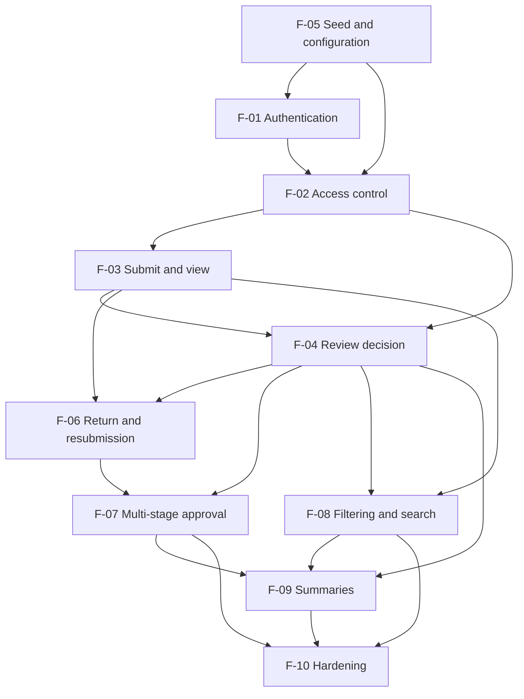

# Three-sprint plan

> **Project Deliverable 1, Part D.** Together the three sprints cover the whole product baseline in
> [`../srs.md`](../srs.md) and [`../features.md`](../features.md). The requirement-by-requirement mapping is in
> [`../traceability.md`](../traceability.md); the Sprint 1 contracts are in [`sprint-1/`](sprint-1/README.md).
> Status: first complete draft (v0.2) for review. Sprint 1 is implemented; Sprints 2 and 3 are planned.

## Version history

| Version | Date | Author | Change | Reason |
|---|---|---|---|---|
| 0.1 | 2026-11-14 | | Skeleton created | Repository structure |
| 0.2 | 2026-11-15 | WirachatTH | First complete plan: the three sprints, the Sprint 1 scope explanation, the dependencies, the allocation check, and the risks | Issue #6 |

---

## 1. Overview

The product is a departmental purchase and funding **approval workflow** (Theme 5). The baseline in the SRS has
18 functional requirements, 18 business rules, and 16 non-functional requirements. They are grouped into ten features
(F-01 to F-10, see `features.md`). Each feature belongs to exactly one sprint.

| Sprint | Goal | Feature IDs | Dependencies | Completion outcome | Checkpoint |
|---|---|---|---|---|---|
| 1 | Small working domain slice with authentication, permissions, and persistence | F-01, F-02, F-03, F-04, F-05 | F-05 first, then F-01, F-02, F-03, F-04 in that order (section 5) | A requester signs in, submits a request, and sees it. The assigned reviewer approves or rejects it with a recorded reason and history. Nobody can approve their own request. Data lives in PostgreSQL and the app is released from `main` | **Deliverable 1** (15 Nov 2026; the handout still shows 8 Nov) |
| 2 | Completed core expansion under engineering contracts | F-06, F-07 | F-06 needs F-03 and F-04. F-07 needs F-04 and F-06 | A reviewer can return a request and the requester can edit and resubmit it. A high-value request needs a second approval by a different reviewer. Everything is deployed from `main` and Sprint 1 still works. Deliverable 2 also needs the contracts of the Sprint 3 features and one Sprint 3 workflow working, so that work starts early (section 3) | **Deliverable 2** (29 Nov 2026) |
| 3 | Remaining features, integration, and product hardening | F-08 (finished), F-09, F-10 | F-09 needs F-04, F-07, F-08. F-10 needs F-01 to F-09 | Filters, decided requests, and summaries work. Accessibility, responsiveness, and performance targets are met and verified. The full regression run passes on the final version | Progress at 29 Nov; **complete by 13 Dec 2026** (Final Delivery) |

Every sprint follows the same engineering workflow (`AGENTS.md` and the Product Definition of Done): an Issue, a
branch from `staging`, the **contract first**, a failing test (red), the implementation (green), a teammate-reviewed
pull request into `staging`, and a release pull request from `staging` into `main` once the sprint's checks pass.

---

## 2. Sprint 1: scope explanation

**Why this slice.** The course asks for the smallest working slice that has authentication, permissions, and
persistence. F-01 to F-05 are that slice for an approval workflow:

| Feature | What it adds | Why it is in Sprint 1 |
|---|---|---|
| F-05 Seed and cloud-ready configuration | The database schema, four demo accounts, configuration from the environment, health and readiness | Everything else needs users and a database, and Lab 5 needs a configuration that runs in the cloud |
| F-01 Authentication | Sign in, stay signed in, sign out, with server-side sessions and a sign-in throttle | There is no domain feature without a known user |
| F-02 Role-based access control | One policy table and one middleware that decide who may call which route | The reviewer operations must be refused to a requester on the server, not only hidden |
| F-03 Submit and view own requests | Submit a request to a chosen reviewer, list one's own requests, open one with its history | It is the first half of the domain journey |
| F-04 Review decision and history | The inbox, approve or reject with a reason, no self-approval, one winner when two decisions collide, permanent history | It is the second half of the journey and holds the rules that make this theme meaningful |

Together they make the domain journey of the theme brief: a requester submits, an assigned reviewer decides with a
recorded reason, the requester sees the result, and the rules (no self-approval, only `SUBMITTED` can be decided,
reviewer scope) are enforced by the backend and by the database.

**What was deliberately left out, and why.**

| Deferred capability | Planned in | Reason it was deferred |
|---|---|---|
| Return for changes, edit and resubmit (FR-13, FR-14) | Sprint 2, F-06 | It adds a new status (`RETURNED`) and an edit path. Sprint 1 refuses edits after submission (BR-15), so reviewers never decide on changing content |
| Second approval for high-value requests (FR-15) | Sprint 2, F-07 | It changes the status model and needs a decision on the threshold and on who may give the second approval (Q-06) |
| Filtering and search, decided requests, paging (FR-16, FR-17) | Sprint 3, F-08 | Sprint 1 lists are small (A-04), and filtering is useful only after the lists hold real data |
| Decision summaries and reports (FR-18) | Sprint 3, F-09 | A summary needs the final statuses, including the second approval |
| Full accessibility, responsiveness, and a measured performance target (NFR-12 to NFR-14), a sign-in throttle shared between instances (Q-08) | Sprint 3, F-10 | They are verified on the finished product, and Sprint 1 only needs the basic usability and keyboard checks (NFR-11) |
| Self-registration, password recovery, account administration, notifications, attachments, delegation | Excluded | They are out of scope in the SRS (section 3.2) |

**Sprint 1 result (for the record).** The Sprint 1 features were built contract first, with 108 acceptance criteria
and their tests, and released from `staging` into `main` as the tag `v1.0.0-sprint1`. The result table is in
`traceability.md` section 4. Deployment on Google Cloud (Lab 5) is tracked in `docs/labs/lab-05/deployment.md`.

---

## 3. Sprint 2

**Goal.** Complete the core expansion: the two workflows that change the status model, under engineering contracts,
and make the product ready for Sprint 3. The course says a required feature may not be moved to Sprint 3 only to mark
the sprint complete, so F-06 and F-07 stay in Sprint 2. Deliverable 2 also asks for the contracts of all remaining features and at least
one Sprint 3 workflow implemented and tested. That is Sprint 3 work started early: F-08, F-09, and F-10 stay allocated
to Sprint 3.

| Feature | What it delivers | Requirements | Decision needed first |
|---|---|---|---|
| F-06 Return and resubmission | The assigned reviewer returns a request with a comment (`RETURNED`). The requester edits and resubmits it under the same number and reviewer. The history shows each return and resubmission | FR-13, FR-14, BR-15, BR-16 | Q-05: what happens to waiting requests when their reviewer can no longer decide |
| F-07 Multi-stage approval | A request above the threshold needs a second approval from a different reviewer. It becomes `APPROVED` only after both approvals, and either reviewer can reject it | FR-15, BR-17 | Q-06: the threshold (provisionally 100,000.00 THB) and the status name |

**Order and dependencies.** F-06 first, because F-07 needs the new status machinery. F-07 comes next.
The early Sprint 3 work (the F-08 contract and its first filter workflow) runs in parallel, because F-08 depends only on Sprint 1 features.

**Completion outcome.**
- Contracts, acceptance criteria, and a test specification for F-06 and F-07, reviewed before any test or code.
- Both workflows work with real database persistence, with the negative and boundary cases tested.
- The contracts of F-08, F-09, and F-10 are written, so the remaining baseline is specified, and the first F-08 workflow works (started early from Sprint 3).
- Sprint 1 behaviour, authentication, backend permissions, and record ownership still pass the regression run.
- A change and defect register that records findings from deployment and from the Lab 6 acceptance test, with the
  decision, the release that fixes it, and the re-test result.
- The release candidate is merged into `main` and deployed through the Lab 5 pipeline.

**Target windows (to be adjusted to the exam timetable).**

| Window | Work |
|---|---|
| 16 to 18 Nov | Decide Q-05 and Q-06. Write the F-06 and F-07 contracts. Start the Sprint 3 contract for F-08 |
| 18 to 22 Nov | F-06: failing tests, then the implementation, reviewed. Lab 6 hand-over and the first findings |
| 23 to 27 Nov | F-07 the same way. The first F-08 workflow (filter My Requests and the Review Inbox) |
| 27 to 28 Nov | Write the contracts of F-09 and F-10. Regression run, release candidate, release pull request, deployment |
| 29 Nov | **Deliverable 2** |

---

## 4. Sprint 3

**Goal.** Finish the remaining features, integrate everything, and harden the product. The product should already be
substantially complete on 29 November, because 1 to 11 December is the examination period. Sprint 3 is therefore
bounded work, not the main workflows.

| Feature | What it delivers | Requirements | Decision needed first |
|---|---|---|---|
| F-08 Filtering, search, and decided requests | Filter and search My Requests, the Review Inbox, and the decided requests by status, date range, amount range, and number or title text. A reviewer sees the requests they decided. Paging for the lists | FR-16, FR-17, BR-18 | None |
| F-09 Decision summaries and reports | Counts and totals by status for a chosen period, and for a reviewer the number approved and rejected, limited to what the viewer may see | FR-18, BR-18 | Q-07: whether summaries need an export |
| F-10 Product hardening | Accessibility checks on every main screen, layouts at three sizes, a timed performance run, a decision on a sign-in throttle shared between instances, error pages, and the full regression run | NFR-12, NFR-13, NFR-14 | Q-08: shared sign-in throttle |

**Order and dependencies.** F-08 is finished first. F-09 needs F-04, F-07, and F-08, because a summary counts the final
statuses. F-10 comes last because it verifies everything.

**Completion outcome.** Every requirement has an explicit status. The accessibility, responsiveness, and performance
targets are measured on the deployed service. The automated regression run passes on the final version, the accepted
release is on `main`, and the same version is deployed with its data.

**Target windows (to be adjusted to the exam timetable).**

| Window | Work |
|---|---|
| 30 Nov to 4 Dec | F-08 completed. F-09 failing tests and the implementation |
| 5 to 9 Dec | F-10: accessibility, responsiveness, performance. Defects and re-tests from acceptance feedback |
| 10 to 12 Dec | Final regression run on `staging`, the release pull request, deployment, the final PDF, and the demonstration video |
| 13 Dec | **Final Delivery** |

---

## 5. Feature dependencies

| Feature | Depends on | Sprint |
|---|---|---|
| F-05 Seed and cloud-ready configuration | None (foundation) | 1 |
| F-01 Authentication | F-05 | 1 |
| F-02 Role-based access control | F-01, F-05 | 1 |
| F-03 Submit and view own requests | F-01, F-02, F-05 | 1 |
| F-04 Review decision and history | F-02, F-03 | 1 |
| F-06 Return and resubmission | F-03, F-04 | 2 |
| F-07 Multi-stage approval | F-04, F-06 | 2 |
| F-08 Filtering, search, and decided requests | F-03, F-04 | 3 (started early, see section 3) |
| F-09 Decision summaries and reports | F-04, F-07, F-08 | 3 |
| F-10 Product hardening | F-01 to F-09 | 3 |

F-10 also depends on F-01 to F-06; the arrows into F-10 show only the last ones to finish.

---

## 6. Allocation check

Each feature is in exactly one sprint, and the sprints together cover the whole baseline in the SRS.

| Sprint | Features | Functional requirements | Business rules | Non-functional requirements |
|---|---|---|---|---|
| 1 | F-01, F-02, F-03, F-04, F-05 | FR-01 to FR-12 | BR-01 to BR-15 | NFR-01 to NFR-07, NFR-09, NFR-11; NFR-08, NFR-10, NFR-15, NFR-16 through Lab 5 |
| 2 | F-06, F-07 | FR-13 to FR-15 | BR-16, BR-17 | none new |
| 3 | F-08, F-09, F-10 | FR-16 to FR-18 | BR-18 | NFR-12 to NFR-14 |
| **Total** | **10 features** | **18** | **18** | **16** |

This matches the "planned sprint" columns of `srs.md` and the allocation in `features.md` and `traceability.md`.
If a later scope change moves a requirement, change this file, `features.md`, and `traceability.md` together and add
a row to the version history of each.

---

## 7. Risks and how the plan handles them

| Risk | Effect | Mitigation |
|---|---|---|
| Two people, with the examination period from 1 to 11 December | Little time in Sprint 3 | The main workflows are finished by 29 November. Sprint 3 holds bounded work, and F-08 starts in Sprint 2 |
| The multi-stage threshold and the interim status (Q-06) are not confirmed | F-07 could change late | Decide it in the first days of Sprint 2 and write it into the F-07 contract before any test |
| Findings from deployment and the Lab 6 acceptance test | Unplanned fixes | Keep them in the change and defect register. Fix them test first, with a regression run before each release |
| The cloud setup is late | The deployed checks come late | The pipeline is written and tested offline. The release is repeated by one workflow run as soon as the project exists |
| A later feature breaks an earlier rule | Lost authorization or ownership behaviour | Every new route needs a policy and tests. The Sprint 1 tests run on every pull request |
