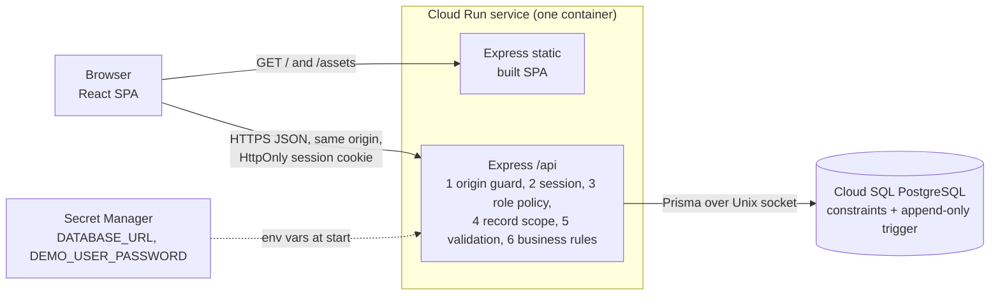
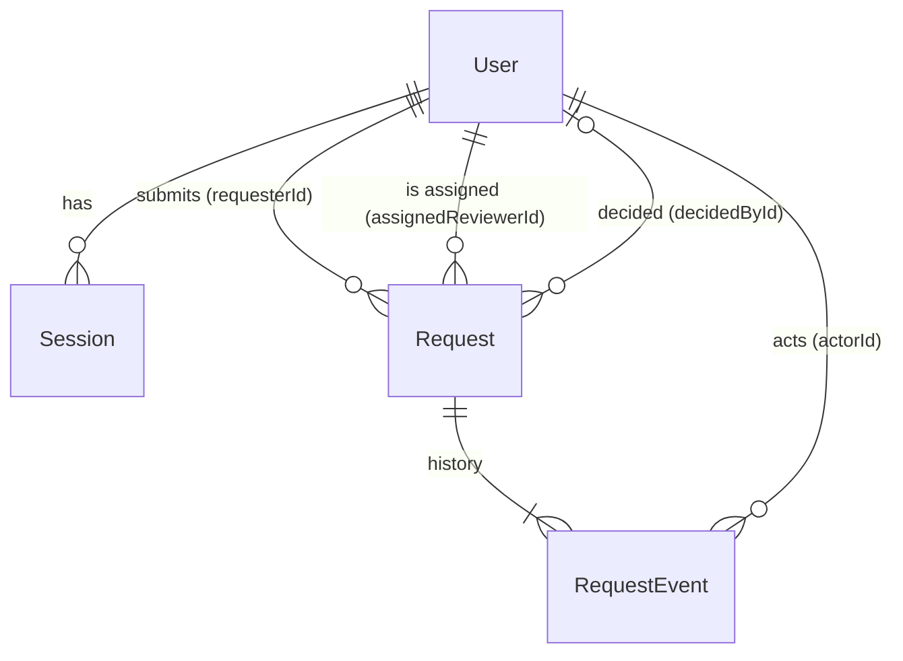
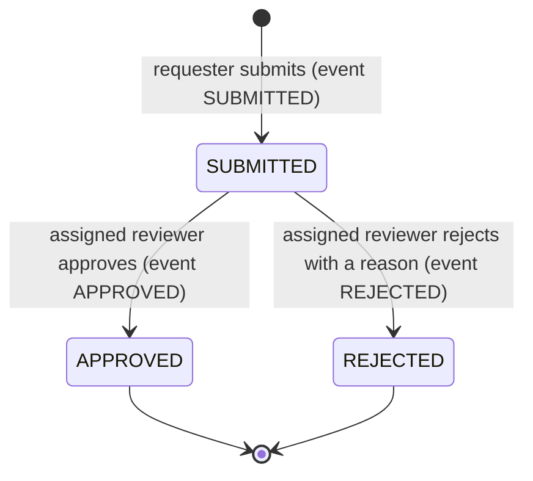

# System-Level Software Design Specification (SDS)

> **Project Deliverable 1, Part C.** This document defines the shared architecture, data model, conventions,
> access rules, and delivery design for the Workflow & Approval System (Theme 5).
> Feature contracts in `docs/sprints/sprint-*/` give the detailed endpoints, screens, and tests.
>
> **Requirement links.** Rules are named here in words. Their stable `FR`/`BR`/`NFR` IDs come from
> [`srs.md`](srs.md) (Issue #3), and [`traceability.md`](traceability.md) (Issue #5) maps them to this design.
> Where the SRS sets a value this design depends on, it is marked *(SRS)*. The value shown is the proposal
> from the team plan.

## Version history

| Version | Date | Author | Change | Reason |
|---|---|---|---|---|
| 0.1 | 2026-11-14 | Menelaus122 | Skeleton created | Repository structure (#2) |
| 0.2 | 2026-11-14 | Menelaus122 | First complete draft | Issue #4 |

---

## 1. Stack and component responsibilities

| Layer | Technology | Responsibility |
|---|---|---|
| UI | React 18 + TypeScript, Vite, React Router | Screens, navigation by role, client-side validation for fast feedback, and loading/empty/error states. Holds no authority: every rule is enforced again by the API. |
| API / application | Node 22 + TypeScript, Express 4 | Authentication, the route-policy authorization table, request validation, business rules and status transitions, and safe error responses. |
| Data access | Prisma 5 (client + Migrate) | Typed queries, transactions, and migrations. Constraints Prisma cannot express (`CHECK`, trigger) are hand-written in migration SQL. |
| Database | PostgreSQL 16 | The system of record for users, sessions, requests, and history. Integrity constraints are the last line of defence for the business rules. |
| Unit and API tests | Vitest + Supertest | Unit tests for rules; API tests against a real PostgreSQL for persistence and permissions. |
| End-to-end tests | Playwright (Chromium) | Selected journeys through the real UI, API, and database. |
| Packaging | Docker (one multi-stage image) | One image serves the built SPA and the API on `$PORT`. The same image runs the migration and seed job. |
| Hosting | GCP: Cloud Run, Cloud SQL, Artifact Registry, Secret Manager | See section 9. |

**Reuse.** The authentication, session, password, throttling, and route-policy modules, and the UI shell and
components, are adapted from the team's TokTickIT Lab 4 release (`WirachatTH/toktickit`, `main` @ `0f01560`).
The ticket domain, attachments, comments, dashboards, administrator user management, and forced password change
are **not** carried over.

## 2. Architecture

**Communication.** The browser loads the SPA from the same origin as the API, so the session cookie is
first-party and no CORS is needed in production. The SPA calls `/api/...` with `credentials: "include"` and
JSON bodies. Locally, the Vite dev server (port 5173) proxies `/api` to Express (port 3000), so local
development keeps the same single-origin behaviour.

**Where rules are enforced.**

| Concern | Enforced in | Backed by |
|---|---|---|
| Who the caller is | `attachSession` middleware (session cookie → `Session` row → `User`) | `Session.tokenHash` unique; expiry checked on every request |
| Which role may call a route | One route-policy table applied by one middleware before any handler (adapted from TokTickIT `authorization.ts`) | A route missing from the table answers `404` and is never reachable unguarded |
| Which records a caller may see or change | Handler queries are scoped to the caller (`requesterId = me` or `assignedReviewerId = me`) | Foreign keys; a `404` for out-of-scope records |
| Input validity | Handler validation before any write | Column types, lengths, `CHECK (amount > 0 AND amount <= max)` |
| Assignment rule (reviewer is an active `REVIEWER`, not the requester) | Submission handler | `CHECK (requester_id <> assigned_reviewer_id)` |
| Status transitions, no self-approval, assigned reviewer only | Decision handler, inside one transaction with a conditional update | `CHECK` tying decision fields to status; the conditional `WHERE status = 'SUBMITTED'` |
| Immutable history | No API updates or deletes events; each event is written in the same transaction as its status change | A trigger rejects `UPDATE` and `DELETE` on `request_event` |

The client also hides controls a role cannot use, but that is feedback for people, never the boundary.

## 3. Data model

### 3.1 Entities

| Entity | Key fields | Relationships | Constraints | Ownership |
|---|---|---|---|---|
| `User` | `id`, `name` (1–100), `email` (stored trimmed and lowercased), `passwordHash` (scrypt string), `role` (`REQUESTER` \| `REVIEWER`), `isActive`, `createdAt`, `updatedAt` | has many `Session`, requests as requester, requests as assigned reviewer, events as actor | `email` unique; users are deactivated, never deleted | Self |
| `Session` | `id`, `tokenHash` (SHA-256 hex of the cookie token), `userId`, `createdAt`, `expiresAt` | belongs to `User` (`ON DELETE CASCADE`: a session is not history) | `tokenHash` unique; indexes on `userId`, `expiresAt` | The user it belongs to |
| `Request` | `id`, `requestNumber` (`REQ-######`), `requesterId`, `assignedReviewerId`, `title` (1–120), `description` (1–2000), `amount` (`DECIMAL(12,2)`, THB), `status`, `decidedById`, `decisionReason`, `decidedAt`, `createdAt`, `updatedAt` | belongs to `User` (requester), `User` (assigned reviewer), `User` (decider, nullable); has many `RequestEvent` | see 3.3; FKs `ON DELETE RESTRICT`; indexes `(requesterId, createdAt)`, `(assignedReviewerId, status)` | The requester owns it; the assigned reviewer may decide it |
| `RequestEvent` | `id`, `requestId`, `actorId`, `type` (`SUBMITTED` \| `APPROVED` \| `REJECTED`), `fromStatus` (nullable), `toStatus`, `reason` (nullable), `createdAt` | belongs to `Request` and `User` (actor), both `ON DELETE RESTRICT` | append-only (trigger); index `(requestId, createdAt, id)` | Part of its request's history; visible to whoever may see the request |

**Enums.**
- `Role`: `REQUESTER`, `REVIEWER`. One role per account in Sprint 1. A `REVIEWER` may also submit requests, which makes "no self-approval" a real, testable rule *(SRS)*.
- `RequestStatus`: `SUBMITTED`, `APPROVED`, `REJECTED`. Sprint 2 adds `RETURNED` with `ALTER TYPE ... ADD VALUE`, which is additive.

### 3.2 Diagrams

Every other transition is invalid and answers `409 INVALID_TRANSITION`. Sprint 2 adds
`SUBMITTED → RETURNED → SUBMITTED` (return and resubmission).

### 3.3 Constraints that protect the business rules

| Constraint | Rule it protects |
|---|---|
| `CHECK (amount > 0 AND amount <= 1000000.00)` | Amount is positive and within the maximum *(SRS: maximum)* |
| `CHECK (requester_id <> assigned_reviewer_id)` | Nobody is assigned their own request |
| `CHECK ((status = 'SUBMITTED') = (decided_at IS NULL AND decided_by_id IS NULL))` | A decided request always records who decided and when; a submitted one never does |
| `CHECK (status <> 'REJECTED' OR length(btrim(decision_reason)) > 0)` | A rejection always has a reason |
| `UNIQUE (request_number)` | Request numbers are unique |
| `request_number` default `'REQ-' \|\| lpad(nextval('request_number_seq')::text, 6, '0')` | The number is generated by the database, never by the client |
| Trigger `request_event_append_only` (`BEFORE UPDATE OR DELETE ... RAISE EXCEPTION`) | History cannot be changed or removed, even by a bug |
| FKs `ON DELETE RESTRICT` on requests and events | Deleting a user or request cannot erase history |

Whether the assigned reviewer is an *active `REVIEWER`* depends on another row, so it cannot be a `CHECK`.
The submission handler enforces it inside the same transaction as the insert.

### 3.4 Database setup, migrations, and seed

- **Setup.** Local development runs PostgreSQL 16 in Docker Compose. Cloud runs Cloud SQL (section 9). The only
  connection setting is `DATABASE_URL`.
- **Migrations.** Prisma Migrate. Locally `prisma migrate dev`; in CI and in the Cloud Run job
  `prisma migrate deploy`. Hand-written SQL in the migration adds the `CHECK` constraints, the sequence, and the
  trigger.
  - After the first release, **migrations are additive only** (new tables, columns, enum values), so the previous
    image keeps working after a rollback.
  - An applied migration is never edited.
- **Seed** (`prisma/seed.ts`) is idempotent: it upserts by email, so running it again changes nothing.
  - **Accounts:** two requesters and two reviewers, with synthetic names and `@example.com` emails.
  - **Passwords:** read from `DEMO_USER_PASSWORD`. With `NODE_ENV=production`, the seed refuses to run without it.
    Passwords are never printed or logged.
  - **No requests:** the seed creates none; tests create their own data.

## 4. UI

### 4.1 Screens and navigation

| Screen | Route | Roles | Purpose |
|---|---|---|---|
| Login | `/login` | unauthenticated | Email and password; one generic error for wrong credentials |
| My Requests | `/requests` | `REQUESTER`, `REVIEWER` | The caller's own requests, newest first: number, title, amount, status, assigned reviewer |
| New Request | `/requests/new` | `REQUESTER`, `REVIEWER` | Title, description, amount (THB), and reviewer (a list of active reviewers excluding the caller) |
| Request Detail | `/requests/:id` | the requester, or the assigned reviewer | Fields, status, decision, and history. The assigned reviewer of a `SUBMITTED` request sees the decision panel. |
| Review Inbox | `/reviews` | `REVIEWER` | `SUBMITTED` requests assigned to the caller, oldest first |

The header shows the product name, the navigation for the caller's role, the caller's name and role, and
**Log out**. Navigation by role:
- `REQUESTER`: My Requests and New Request.
- `REVIEWER`: Review Inbox, My Requests, and New Request.

After login, a requester lands on My Requests and a reviewer on Review Inbox.

### 4.2 Shared UI behaviour

| State | Behaviour |
|---|---|
| Validation | Each message appears beneath its field and is linked with `aria-describedby`. Typed values are kept and focus moves to the first invalid field. The client checks the same rules as the API for fast feedback, and the API's `fields` messages are shown the same way. |
| Loading | Lists and details show a spinner with a text label. A submitting button is disabled and reads "Saving…", which also prevents double submission. |
| Empty | My Requests: "You have not submitted any requests yet", with a link to New Request. Review Inbox: "No requests are waiting for your review." |
| Error | `500` or a network failure: a message with a **Try again** action; values in a form are kept. |
| Unauthenticated (`401`) | Back to Login, with "Your session has ended. Please log in again." |
| Forbidden or not found (`403`/`404`) | "This page is not available to you", with no record data. A requester who types `/reviews` sees this. |
| Status | A badge with text, not colour alone: `SUBMITTED` (amber), `APPROVED` (green), `REJECTED` (red). |
| Formats | Amounts as THB with two decimals; dates and times in Asia/Bangkok. |

## 5. API conventions

| Topic | Convention |
|---|---|
| Base path | `/api`. Resources are plural nouns; IDs in paths are integers. |
| Format | JSON in and out (`Content-Type: application/json`), body limit 100 KB. Timestamps are ISO-8601 UTC. Amounts are decimal **strings** (`"1250.00"`) so no precision is lost. |
| Authentication | The session cookie only. A client-supplied user ID, role, or `requesterId` in a body is ignored. |
| Guard order | 1 origin guard (state-changing methods) → 2 session → 3 role policy → 4 record scope → 5 validation → 6 business rules. The first failure answers; the JSON body is read only after step 3, so a caller who may not use a route learns nothing by sending one. |
| Success | `200` read or decision, `201` create (with the created resource), `204` logout. |
| Error envelope | `{ "error": { "code": "VALIDATION_ERROR", "message": "Some fields need attention.", "fields": { "amount": "Enter an amount greater than 0." } } }`. `message` is always safe to show: no stack trace, SQL, file path, or secret. |
| Lists | Sprint 1 lists are not paginated (the data set is small). F-08 (Sprint 3) adds filtering and pagination. |
| Logging | One line per request (method, path, status, duration, user ID). Never a password, token, cookie, or `DATABASE_URL`. |

**Endpoints** (detailed in the contracts):

| Method and path | Policy | Contract |
|---|---|---|
| `GET /api/health` | public (liveness) | F-05 |
| `GET /api/ready` | public; `503` if the database is unreachable | F-05 |
| `POST /api/auth/login` | public; throttled | F-01 |
| `POST /api/auth/logout` | with or without a session | F-01 |
| `GET /api/auth/me` | any signed-in user | F-01 |
| `GET /api/reviewers` | any signed-in user | F-03 |
| `POST /api/requests` | `REQUESTER`, `REVIEWER` | F-03 |
| `GET /api/requests/mine` | `REQUESTER`, `REVIEWER` | F-03 |
| `GET /api/requests/:id` | `REQUESTER`, `REVIEWER`; record scope | F-03 |
| `GET /api/reviews/inbox` | `REVIEWER` | F-04 |
| `POST /api/requests/:id/decision` | `REVIEWER`; record scope and rules | F-04 |

**Error codes:**

| Code | Status | Meaning |
|---|---|---|
| `VALIDATION_ERROR` | 400 | A field or parameter failed validation (see `fields`), including a rejection without a reason |
| `UNAUTHENTICATED` | 401 | No session, an unknown token, or an expired session |
| `INVALID_CREDENTIALS` | 401 | Login: unknown email or wrong password, with one message for both |
| `ACCOUNT_INACTIVE` | 403 | Login: correct password for a deactivated account |
| `FORBIDDEN` | 403 | The role may not call this route (for example a `REQUESTER` calling the inbox or a decision) |
| `FORBIDDEN_ORIGIN` | 403 | A state-changing request from an origin not in `CLIENT_ORIGINS` |
| `SELF_APPROVAL_FORBIDDEN` | 403 | A reviewer tried to decide a request they submitted |
| `NOT_FOUND` | 404 | The record does not exist, or the caller is neither its requester nor its assigned reviewer |
| `INVALID_TRANSITION` | 409 | The request is not `SUBMITTED` (already decided), including the loser of two competing decisions |
| `TOO_MANY_ATTEMPTS` | 429 | Login throttled for this email; a `Retry-After` header gives the seconds |
| `INTERNAL_ERROR` | 500 | An unexpected failure; the message is always "Something went wrong. Please try again." |

**Competing decisions.** The decision runs in one transaction: a conditional update
`... SET status = $new, decided_by_id = $me, decided_at = now(), decision_reason = $reason WHERE id = $id AND status = 'SUBMITTED' AND assigned_reviewer_id = $me`,
then one `RequestEvent` insert. If the update touches no row, the handler re-reads the request to answer `404`,
`403`, or `409`, and writes nothing. Two simultaneous decisions therefore give exactly one success, one `409`,
and one event.

## 6. Roles and permission matrix

> Enforced in the backend for every protected operation. A hidden frontend control is not authorization.

| Operation | Unauthenticated | `REQUESTER` | `REVIEWER` | Record scope |
|---|---|---|---|---|
| Log in | ✅ | ✅ | ✅ | — |
| Log out, current user (`/me`) | logout only | ✅ | ✅ | Own session |
| List active reviewers for assignment | ❌ 401 | ✅ | ✅ | Excludes the caller |
| Submit a request | ❌ 401 | ✅ | ✅ | Requester = caller; reviewer is an active `REVIEWER` ≠ caller |
| List my requests | ❌ 401 | ✅ | ✅ | `requesterId = caller` |
| View request detail and history | ❌ 401 | ✅ own | ✅ own or assigned | Otherwise `404`, no data |
| List review inbox | ❌ 401 | ❌ 403 | ✅ | `assignedReviewerId = caller`, `SUBMITTED` |
| Approve or reject | ❌ 401 | ❌ 403 | ✅ assigned only | Own request → `403 SELF_APPROVAL_FORBIDDEN`; unrelated → `404`; decided → `409` |
| Edit or delete a request or event | ❌ | ❌ | ❌ | No such endpoint in Sprint 1 *(SRS: no edit after submission)* |

## 7. Authentication and session

| Topic | Design |
|---|---|
| Password hashing | Node `crypto.scrypt`, N = 16384, r = 8, p = 1, 64-byte key, 16-byte random salt, stored as `scrypt$N$r$p$salt$hash` so the cost can be raised later. Verification uses `timingSafeEqual`. An unknown email still runs one scrypt against a dummy hash, so response time does not reveal which emails exist. |
| Password rules | 10–128 characters, at least one letter and one digit, not equal to the email. The seed checks `DEMO_USER_PASSWORD` against these rules. |
| Login | `POST /api/auth/login` with `{ email, password }`. The email is trimmed and lowercased. Unknown email or wrong password → `401 INVALID_CREDENTIALS` (one message); a correct password on an inactive account → `403 ACCOUNT_INACTIVE`. On success, the user's expired sessions are removed and a new session is created. |
| Session token | 32 random bytes, base64url, sent only in the `af_session` cookie. The database stores only its SHA-256, so there is no signing secret to configure or leak. |
| Cookie | `HttpOnly`, `SameSite=Strict`, `Path=/api`, `Max-Age=28800` (8 hours), and `Secure` when `NODE_ENV=production`. |
| Expiry | 8 hours from login, checked on every request. An expired session is treated as none (`401`) and its row is deleted. A deactivated user's sessions are not honoured. |
| Current user | `GET /api/auth/me` returns `{ id, name, email, role }` from the session, never the hash or the token. The SPA calls it on load to decide between Login and the app. |
| Logout | `POST /api/auth/logout` deletes the session row and clears the cookie. The old cookie then answers `401`. |
| Throttling | 5 failed logins per normalised email in a sliding 15-minute window → `429 TOO_MANY_ATTEMPTS` with `Retry-After`. Attempts are reserved before the password check, so a burst cannot slip past the limit. Unknown emails count the same as real ones. |
| Cross-origin guard | `POST` requests whose `Origin` header is not in `CLIENT_ORIGINS` answer `403 FORBIDDEN_ORIGIN` before the session lookup. This adds to `SameSite=Strict`. |
| Not in Sprint 1 | Self-registration, password recovery, password change, and account administration *(SRS exclusions)*. Accounts come only from the seed. |

**Known limitation (decision for the SRS).** The login throttle lives in each process's memory, as it did in
TokTickIT. On Cloud Run, with up to 3 instances and scale-to-zero, each instance counts separately and a restart
clears the count. Sprint 1 accepts this; F-10 (hardening) can move the counter into the database.

## 8. Configuration and secrets

Every setting comes from environment variables; nothing environment-specific is in the code or the image.
The final list, with where each value comes from, lives in
[`labs/lab-05/deployment.md`](labs/lab-05/deployment.md) and in `.env.example` (Issue #8).

| Variable | Read by | Purpose | Secret? | Local source | Cloud source |
|---|---|---|---|---|---|
| `DATABASE_URL` | server, seed, migrations | PostgreSQL connection string | **Yes** | `.env` (not committed) | Secret Manager |
| `DEMO_USER_PASSWORD` | seed | Password for the seeded demo accounts | **Yes** | `.env` | Secret Manager |
| `PORT` | server | HTTP port (default 3000) | No | default | Set by Cloud Run |
| `NODE_ENV` | server, seed | `development` or `production` (cookie `Secure`, seed strictness) | No | `.env` | Cloud Run env var |
| `CLIENT_ORIGINS` | server | Comma-separated allowed origins for the origin guard | No | default `http://localhost:5173` | Cloud Run env var (the service URL) |
| `VITE_API_URL` | client build | API base URL; empty means same origin | No | `client/.env` | Empty at image build |

**Rules:**
- Commit only `.env.example`, with placeholders.
- Secrets never appear in the client bundle (only `VITE_*` values reach it, and none of them is secret), in logs, or in screenshots.
- Runtime secrets live in Secret Manager; pipeline settings live in GitHub Actions variables.
- No GCP service-account JSON key exists: GitHub signs in with Workload Identity Federation.

## 9. Deployment design (GCP)

Adapted from the Lab 5 Starter Kit. Resource names are proposals and are finalised in `deployment.md`.

| Component | Purpose | Proposed name / setting |
|---|---|---|
| Artifact Registry (Docker) | Stores every image, tagged with the full commit SHA | `approval-flow` |
| Cloud Run service | Runs the image; serves the SPA and the API over HTTPS; deployed by image digest | `approval-flow`; region `asia-southeast1`; min instances 0, max 3 |
| Cloud Run job | Runs `prisma migrate deploy`, then the seed, from the same image before each deploy | `approval-flow-migrate` |
| Cloud SQL for PostgreSQL | Durable data: users, sessions, requests, history | `approval-flow-pg`, PostgreSQL 16, `db-f1-micro` (enterprise edition), storage auto-increase off; database `approval_flow`; connected over the Cloud SQL Unix socket with `connection_limit=3` |
| Secret Manager | `DATABASE_URL`, `DEMO_USER_PASSWORD` | `approval-flow-database-url`, `approval-flow-demo-password` |
| Service accounts | Runtime: `cloudsql.client` plus access to each secret. Deployer: used by GitHub Actions through Workload Identity Federation. | `approval-flow-runner`, `approval-flow-deployer` |
| GitHub Actions | `ci-docker.yml` on every PR (install, migrate, seed, test, build, docker build; required check). `deploy.yml` on merge to `main` (build and push → migrate job → deploy by digest → read-only smoke test; manual rollback by image tag). | — |

**Durability.**
- Containers keep no state: sessions and all data live in Cloud SQL, and there are no uploaded files.
- Data survives a restart and a redeploy, and a rollback works because migrations are additive.
- The running revision's image tag is the full commit SHA, which identifies the release.
- Cost control: an alerts-only budget, scale-to-zero, the smallest database tier, and pausing Cloud SQL when idle.
