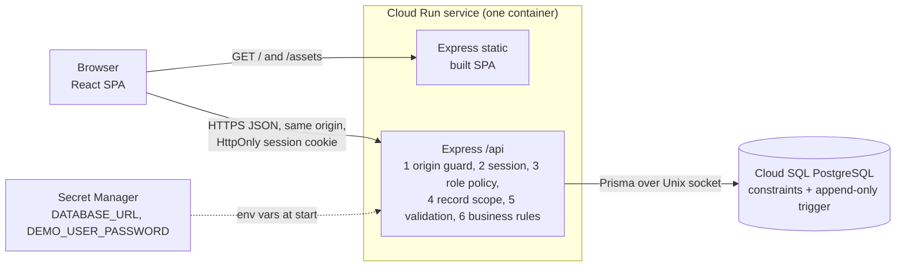
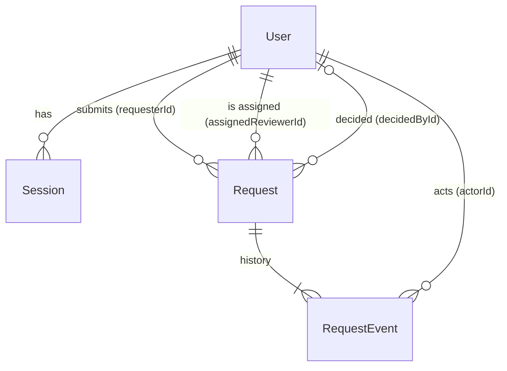
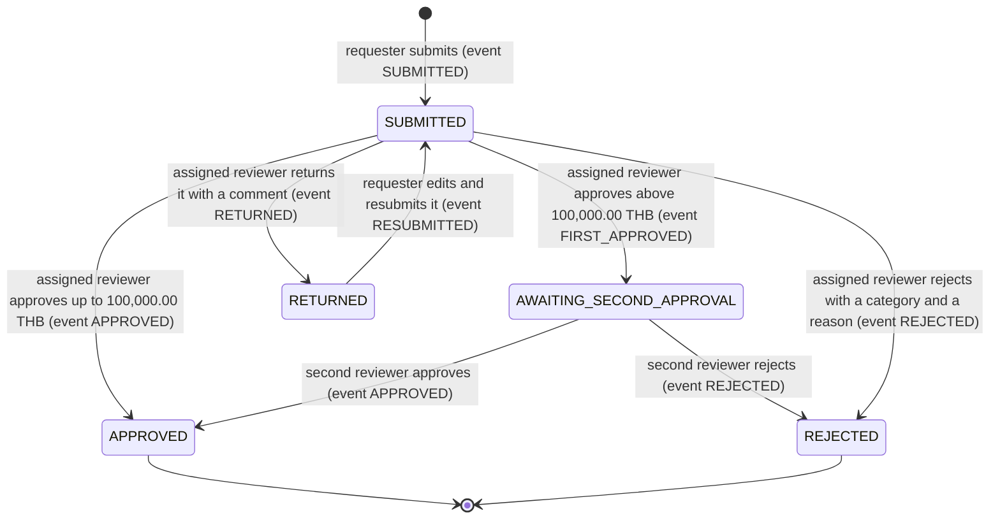

# System-Level Software Design Specification (SDS)

> **Project Deliverable 1, Part C.** This document defines the shared architecture, data model, conventions,
> access rules, and delivery design for the Workflow & Approval System (Theme 5).
> Feature contracts in `docs/sprints/sprint-*/` give the detailed endpoints, screens, and tests.
>
> **Requirement links.** Requirement IDs (`FR`, `BR`, `NFR`, `D`) refer to [`srs.md`](srs.md).
> [`traceability.md`](traceability.md) (Issue #5) maps every requirement to its feature, design, and tests.

## Version history

| Version | Date | Author | Change | Reason |
|---|---|---|---|---|
| 0.1 | 2026-11-14 | Menelaus122 | Skeleton created | Repository structure (#2) |
| 0.2 | 2026-11-14 | Menelaus122 | First complete draft | Issue #4 |
| 0.3 | 2026-11-14 | Menelaus122 | Rejection-reason `CHECK` made NULL-safe; `NOT NULL` columns stated; naming convention and `ApprovalRequest` model name; origin-guard behaviour and `CLIENT_ORIGINS` on Cloud Run; aligned with the F-05 contract (`DEMO_USER_PASSWORD` required everywhere, `NODE_ENV=test`, read-then-write seed) | Review of PR #18 and PR #19 |
| 0.4 | 2026-11-14 | Menelaus122 | Node 24, as agreed for local, Docker, and CI. Table `app_user`. Named constraints, with the stricter `request_decision_fields` `CHECK`. Reasons up to 1000 characters. Guard order with the policy lookup before the session. `413 PAYLOAD_TOO_LARGE`. `{ "user": ... }` responses. `CLIENT_ORIGINS` set from the deterministic URL before the first deploy. Migrations backward-compatible rather than strictly additive. *(SRS)* markers replaced by requirement IDs. | Reviews of PRs #20 and #22–#25; team decision on Node 24 |
| 0.5 | 2026-11-26 | Menelaus122 | BR-12 change: the 10-character minimum of a rejection reason is checked by the application only. No table, constraint, or migration changes. | Change request #65 (Lab 7) |
| 0.6 | 2026-11-26 | Menelaus122 | Rejection category: enum `RejectionCategory`, nullable columns `request.decision_category` and `request_event.category`, two `CHECK` constraints, one additive migration. | Change request #65 (Lab 7) |
| 0.7 | 2026-11-26 | Menelaus122 | The rejection category of 0.6 is applied as two additive migrations, the columns first and the `CHECK` constraints second (F-04 v0.10). No table, column, or constraint changes. | Review of PR #66 |
| 0.8 | 2026-11-27 | Menelaus122 | Return and resubmission (F-06): status `RETURNED`, history types `RETURNED` and `RESUBMITTED`, column `request.revision`, three `CHECK` constraints in two additive migrations, two routes, and the error codes `SELF_REVIEW_FORBIDDEN`, `NOT_REQUESTER`, and `STALE_REVISION`. The decision also checks the revision. | Issue #71 |
| 0.9 | 2026-11-27 | Menelaus122 | Second approval (F-07): status `AWAITING_SECOND_APPROVAL`, history type `FIRST_APPROVED`, two first-approval columns, four `CHECK` constraints in two additive migrations, the error code `SAME_APPROVER_FORBIDDEN`, wider record scope for reviewers, and a third reviewer in the seed. | Issue #76 |
| 0.10 | 2026-11-27 | Menelaus122 | Section 3.4: the new enum values of Sprint 2 are a decided exception to the rollback rule (SRS D-15). | Review of PR #73 |
| 0.11 | 2026-11-27 | Menelaus122 | A fifth constraint of F-07, `request_first_approval_scope`. | Review of PR #77 |
| 0.12 | 2026-11-28 | Menelaus122 | F-08: filters on the lists, the decided route and screen, and paging (slices 2 and 3 in Sprint 3). | Issue #79 (F-08) |
| 0.13 | 2026-11-28 | Menelaus122 | F-09: the Summary screen and its route. | Issue #84 (F-09) |

---

## 1. Stack and component responsibilities

| Layer | Technology | Responsibility |
|---|---|---|
| UI | React 18 + TypeScript, Vite, React Router | Screens, navigation by role, client-side validation for fast feedback, and loading/empty/error states. Holds no authority: every rule is enforced again by the API. |
| API / application | Node 24 + TypeScript, Express 4 | Authentication, the route-policy authorization table, request validation, business rules and status transitions, and safe error responses. |
| Data access | Prisma 5 (client + Migrate) | Typed queries, transactions, and migrations. Constraints Prisma cannot express (`CHECK`, trigger) are hand-written in migration SQL. |
| Database | PostgreSQL 16 | The system of record for users, sessions, requests, and history. Integrity constraints are the last line of defence for the business rules. |
| Unit and API tests | Vitest + Supertest | Unit tests for rules; API tests against a real PostgreSQL for persistence and permissions. |
| End-to-end tests | Playwright (Chromium) | Selected journeys through the real UI, API, and database. |
| Packaging | Docker (one multi-stage image) | One image serves the built SPA and the API on `$PORT`. The same image runs the migration and seed job. |
| Hosting | GCP: Cloud Run, Cloud SQL, Artifact Registry, Secret Manager | See section 9. |

**Reuse.** The authentication, session, password, throttling, and route-policy modules, and the UI shell and
components, are adapted from the team's TokTickIT Lab 4 release (`WirachatTH/toktickit`, `main` @ `0f01560`).
The ticket domain, attachments, comments, dashboards, administrator user management, and forced password change
are **not** carried over.

## 2. Architecture

**Communication.** The browser loads the SPA from the same origin as the API, so the session cookie is
first-party and no CORS is needed in production. The SPA calls `/api/...` with `credentials: "include"` and
JSON bodies. Locally, the Vite dev server (port 5173) proxies `/api` to Express (port 3000), so local
development keeps the same single-origin behaviour.

**Where rules are enforced.**

| Concern | Enforced in | Backed by |
|---|---|---|
| Who the caller is | `attachSession` middleware (session cookie → `Session` row → `User`) | `Session.tokenHash` unique; expiry checked on every request |
| Which role may call a route | One route-policy table applied by one middleware before any handler (adapted from TokTickIT `authorization.ts`) | A route missing from the table answers `404` and is never reachable unguarded |
| Which records a caller may see or change | Handler queries are scoped to the caller (`requesterId = me` or `assignedReviewerId = me`) | Foreign keys; a `404` for out-of-scope records |
| Input validity | Handler validation before any write | Column types, lengths, `CHECK (amount > 0 AND amount <= max)` |
| Assignment rule (reviewer is an active `REVIEWER`, not the requester) | Submission handler | `CHECK (requester_id <> assigned_reviewer_id)` |
| Status transitions, no self-approval, assigned reviewer only | Decision handler, inside one transaction with a conditional update | `CHECK` tying decision fields to status; the conditional `WHERE status = 'SUBMITTED'` |
| Immutable history | No API updates or deletes events; each event is written in the same transaction as its status change | A trigger rejects `UPDATE` and `DELETE` on `request_event` |

The client also hides controls a role cannot use, but that is feedback for people, never the boundary.

## 3. Data model

### 3.1 Entities

| Entity | Key fields | Relationships | Constraints | Ownership |
|---|---|---|---|---|
| `User` | `id`, `name` (1–100), `email` (stored trimmed and lowercased), `passwordHash` (scrypt string), `role` (`REQUESTER` \| `REVIEWER`), `isActive`, `createdAt`, `updatedAt` | has many `Session`, requests as requester, requests as assigned reviewer, events as actor | `email` unique; users are deactivated, never deleted | Self |
| `Session` | `id`, `tokenHash` (SHA-256 hex of the cookie token), `userId`, `createdAt`, `expiresAt` | belongs to `User` (`ON DELETE CASCADE`: a session is not history) | `tokenHash` unique; indexes on `userId`, `expiresAt` | The user it belongs to |
| `Request` (Prisma model `ApprovalRequest`) | `id`, `requestNumber` (`REQ-######`), `requesterId`, `assignedReviewerId`, `title` (1–120), `description` (1–2000), `amount` (`DECIMAL(12,2)`, THB), `status`, `decidedById`, `decisionReason` (≤ 1000), `decisionCategory` (nullable `RejectionCategory`), `decidedAt`, `firstApprovedById`, `firstApprovedAt` (both nullable), `revision` (from 0), `createdAt`, `updatedAt` | belongs to `User` (requester), `User` (assigned reviewer), `User` (decider, nullable), `User` (first approver, nullable); has many `RequestEvent` | see 3.3; FKs `ON DELETE RESTRICT`; indexes `(requesterId, createdAt)`, `(assignedReviewerId, status)` | The requester owns it; the assigned reviewer may decide it |
| `RequestEvent` | `id`, `requestId`, `actorId`, `type` (`SUBMITTED` \| `APPROVED` \| `REJECTED` \| `RETURNED` \| `RESUBMITTED` \| `FIRST_APPROVED`), `fromStatus` (nullable), `toStatus`, `reason` (nullable, ≤ 1000), `category` (nullable `RejectionCategory`), `createdAt` | belongs to `Request` and `User` (actor), both `ON DELETE RESTRICT` | append-only (trigger); index `(requestId, createdAt, id)` | Part of its request's history; visible to whoever may see the request |

**Enums.**
- `Role`: `REQUESTER`, `REVIEWER`. One role per account in Sprint 1. A `REVIEWER` may also submit requests, which makes "no self-approval" a real, testable rule (SRS D-02, BR-10).
- `RequestStatus`: `SUBMITTED`, `APPROVED`, `REJECTED`, `RETURNED` (F-06), and `AWAITING_SECOND_APPROVAL` (F-07). The new values are added with `ALTER TYPE ... ADD VALUE`, which is additive.
- `RequestEventType`: the submission, each decision, each return (`RETURNED`), each resubmission (`RESUBMITTED`), and each first of two approvals (`FIRST_APPROVED`).
- `RejectionCategory`: `BUDGET`, `INCOMPLETE`, `DUPLICATE`, `POLICY`, `OTHER`. Set only on a rejection (BR-12). The list is fixed, so a new value is an additive migration.

**Naming.**
- Prisma models are PascalCase and map to snake_case tables (`@@map`), with snake_case columns (`@map`). The SQL in §3.3 and the migrations uses the snake_case names; the API's JSON uses camelCase.
- `User` maps to the table **`app_user`** (`@@map("app_user")`), because `user` is a reserved word in PostgreSQL. `Session` maps to `session`.
- The request entity's model is **`ApprovalRequest`** (`@@map("request")`), so the Prisma type never clashes with Express's or the browser's global `Request` type. The history model is `RequestEvent` (`@@map("request_event")`).

**Nullability.** Every column is `NOT NULL` except these:
- `request.decided_by_id`, `request.decision_reason`, `request.decided_at`: empty while the request is `SUBMITTED`. On a `RETURNED` request they hold who returned it, when, and the comment; on a waiting request they hold the first approval.
- `request.first_approved_by_id`, `request.first_approved_at`: set only by the first of two approvals.
- `request_event.from_status`: empty on the `SUBMITTED` event.
- `request_event.reason`: optional on approval, required on a return, empty on a resubmission.
- `request.decision_category`, `request_event.category`: set only by a rejection made after the BR-12 change; empty on every other row, including earlier rejections.

In particular `amount`, `title`, `description`, `requester_id`, `assigned_reviewer_id`, `status`, and `request_number` are `NOT NULL`.

### 3.2 Diagrams

Every other transition is invalid and answers `409 INVALID_TRANSITION`. The return and resubmission loop (F-06)
and the second approval (F-07) are Sprint 2.

### 3.3 Constraints that protect the business rules

| Constraint | Rule it protects |
|---|---|
| `request_amount_range`: `CHECK (amount > 0 AND amount <= 1000000.00)` | Amount is positive and within the maximum (BR-04) |
| `request_reviewer_not_requester`: `CHECK (requester_id <> assigned_reviewer_id)` | Nobody is assigned their own request (BR-06) |
| `request_decision_fields`: `CHECK ((status = 'SUBMITTED' AND decided_at IS NULL AND decided_by_id IS NULL AND decision_reason IS NULL) OR (status <> 'SUBMITTED' AND decided_at IS NOT NULL AND decided_by_id IS NOT NULL))` | A decided request always records both who decided and when, and a submitted one has no decider, date, or reason (BR-11) |
| `request_rejection_reason`: `CHECK (status <> 'REJECTED' OR (decision_reason IS NOT NULL AND length(btrim(decision_reason)) > 0))`; `decision_reason` and `request_event.reason` are `varchar(1000)` | A rejection always has a reason that is not empty or blank, and no reason is longer than 1000 characters (BR-12). The 10-character minimum of BR-12 is checked by the application only, not by this constraint |
| `request_category_only_on_rejection`: `CHECK (decision_category IS NULL OR status = 'REJECTED')` | Only a rejected request has a category (BR-12). It does not require one, so earlier rows and the previous image stay valid |
| `request_event_category_only_on_rejection`: `CHECK (category IS NULL OR type = 'REJECTED')` | The same for the history (BR-12, BR-13) |
| `request_return_comment`: `CHECK (status <> 'RETURNED' OR (decision_reason IS NOT NULL AND length(btrim(decision_reason)) > 0))` | A returned request always has a comment (BR-16) |
| `request_event_return_comment`: the same for a `RETURNED` history row and its `reason` | Every return in the history has its comment (BR-13, BR-16) |
| `request_revision_not_negative`: `CHECK (revision >= 0)` | The revision counts resubmissions (BR-16) |
| `request_first_approval_fields`: `CHECK ((first_approved_by_id IS NULL) = (first_approved_at IS NULL))` | A first approval records who and when together (BR-17) |
| `request_awaiting_second_approval`: `CHECK (status <> 'AWAITING_SECOND_APPROVAL' OR (first_approved_by_id IS NOT NULL AND decided_by_id = first_approved_by_id))` | A waiting request has its first approval (BR-17) |
| `request_second_approver_differs`: `CHECK (status NOT IN ('APPROVED', 'REJECTED') OR first_approved_by_id IS NULL OR decided_by_id <> first_approved_by_id)` | The two approvers are different people (BR-17) |
| `request_decider_not_requester`: `CHECK (decided_by_id IS NULL OR decided_by_id <> requester_id)` | Nobody decides their own request (BR-10) |
| `request_first_approval_scope`: `CHECK (first_approved_by_id IS NULL OR (status IN ('AWAITING_SECOND_APPROVAL', 'APPROVED', 'REJECTED') AND first_approved_by_id <> requester_id))` | A first approval exists only where it can, and never by the requester (BR-10, BR-17) |
| `request_number_unique`: `UNIQUE (request_number)` | Request numbers are unique (BR-07) |
| `request_number` default `'REQ-' \|\| lpad(nextval('request_number_seq')::text, 6, '0')` | The number is generated by the database, never by the client |
| Trigger `request_event_append_only` (`BEFORE UPDATE OR DELETE ... RAISE EXCEPTION 'request_event is append-only'`) | History cannot be changed or removed, even by a bug (BR-13). Known gap: row triggers do not fire on `TRUNCATE`; the application never truncates, and F-10 can revoke it from the runtime role. |
| FKs `ON DELETE RESTRICT` on requests and events | Deleting a user or request cannot erase history |

A `CHECK` passes when its expression is `NULL`. So every `CHECK` above either applies only to `NOT NULL` columns
or tests `IS NOT NULL` explicitly, and a test for each constraint inserts the `NULL` case as well as the obvious
bad value.

Whether the assigned reviewer is an *active `REVIEWER`* depends on another row, so it cannot be a `CHECK`.
The submission handler enforces it inside the same transaction as the insert.

### 3.4 Database setup, migrations, and seed

- **Setup.** Local development runs PostgreSQL 16 in Docker Compose. Cloud runs Cloud SQL (section 9). The only
  connection setting is `DATABASE_URL`.
- **Migrations.** Prisma Migrate. Locally `prisma migrate dev`; in CI and in the Cloud Run job
  `prisma migrate deploy`. Hand-written SQL in the migration adds the `CHECK` constraints, the sequence, and the
  trigger.
  - After the first release, every migration is **backward-compatible with the previously deployed revision**.
    Lab 5 migrates before it deploys, so the old image must keep working against the new schema, and a rollback
    must stay possible. Additive changes (new tables, columns, enum values) are the default. A change such as
    Sprint 2's widened `CHECK` for `RETURNED` must still accept every row the previous revision writes. The previous
    revision cannot read a row that holds a new status or history value: a decided exception (SRS D-15).
  - An applied migration is never edited.
- **Seed** (`prisma/seed.ts`) is idempotent. It reads each demo account by email, creates it if it is missing,
  and otherwise writes only the fields that differ. The hash is rewritten only when it no longer verifies against
  `DEMO_USER_PASSWORD`. When nothing differs, no `UPDATE` is issued, so `updated_at` stays unchanged. The details
  are in the F-05 contract.
  - **Accounts:** two requesters and three reviewers (the third added by F-07), with synthetic names and `@example.com` emails.
  - **Passwords:** read from `DEMO_USER_PASSWORD`, which is required in every environment. There is no default in
    code, so the seed refuses to run without it. Passwords are never printed or logged.
  - **No requests:** the seed creates none; tests create their own data.

## 4. UI

### 4.1 Screens and navigation

| Screen | Route | Roles | Purpose |
|---|---|---|---|
| Login | `/login` | unauthenticated | Email and password; one generic error for wrong credentials |
| My Requests | `/requests` | `REQUESTER`, `REVIEWER` | The caller's own requests, newest first: number, title, amount, status, assigned reviewer; with filters (F-08) |
| New Request | `/requests/new` | `REQUESTER`, `REVIEWER` | Title, description, amount (THB), and reviewer (a list of active reviewers excluding the caller) |
| Request Detail | `/requests/:id` | the requester, or the assigned reviewer | Fields, status, decision, and history. The assigned reviewer of a `SUBMITTED` request sees the decision panel and the return panel; the requester of a `RETURNED` request sees the resubmit form. An eligible second reviewer of a waiting request sees the decision panel. |
| Review Inbox | `/reviews` | `REVIEWER` | `SUBMITTED` requests assigned to the caller and waiting requests the caller may decide, oldest first; with filters (F-08) |
| Decided (F-08 slice 2) | `/reviews/decided` | `REVIEWER` | The requests the caller approved or rejected, newest decision first, with filters |
| Summary (F-09) | `/summary` | `REQUESTER`, `REVIEWER` | Counts and totals by status for a period; a reviewer also sees their own decisions |

The header shows the product name, the navigation for the caller's role, the caller's name and role, and
**Log out**. Navigation by role:
- `REQUESTER`: My Requests and New Request.
- `REVIEWER`: Review Inbox, My Requests, and New Request; and Decided from F-08 slice 2. Both roles gain Summary with F-09.

After login, a requester lands on My Requests and a reviewer on Review Inbox.

### 4.2 Shared UI behaviour

| State | Behaviour |
|---|---|
| Validation | Each message appears beneath its field and is linked with `aria-describedby`. Typed values are kept and focus moves to the first invalid field. The client checks the same rules as the API for fast feedback, and the API's `fields` messages are shown the same way. |
| Loading | Lists and details show a spinner with a text label. A submitting button is disabled and reads "Saving…", which also prevents double submission. |
| Empty | My Requests: "You have not submitted any requests yet", with a link to New Request. Review Inbox: "No requests are waiting for your review." A filtered list without a match: "No requests match these filters." (F-08) |
| Error | `500` or a network failure: a message with a **Try again** action; values in a form are kept. |
| Unauthenticated (`401`) | Back to Login, with "Your session has ended. Please log in again." |
| Forbidden or not found (`403`/`404`) | "This page is not available to you", with no record data. A requester who types `/reviews` sees this. |
| Status | A badge with text, not colour alone: `SUBMITTED` (amber), `APPROVED` (green), `REJECTED` (red), `RETURNED` (blue), `AWAITING_SECOND_APPROVAL` (purple). |
| Formats | Amounts as THB with two decimals; dates and times in Asia/Bangkok. |

## 5. API conventions

| Topic | Convention |
|---|---|
| Base path | `/api`. Resources are plural nouns; IDs in paths are integers. |
| Format | JSON in and out (`Content-Type: application/json`), body limit 100 KB (larger → `413 PAYLOAD_TOO_LARGE`). Timestamps are ISO-8601 UTC. Amounts are decimal **strings** (`"1250.00"`) so no precision is lost. |
| Authentication | The session cookie only. A client-supplied user ID, role, or `requesterId` in a body is ignored. |
| Guard order | 1 origin guard (state-changing methods) → 2 policy lookup (an unlisted method or path → `404`; routing is case-sensitive and strict) → 3 session, only for `roles` and `optional` routes → 4 role → 5 record scope → 6 validation → 7 business rules. The first failure answers. The JSON body is read only after step 4, so a caller who may not use a route learns nothing by sending one. `public` routes such as `/api/health` and `/api/ready` never look up a session. |
| Success | `200` read or decision, `201` create (with the created resource), `204` logout. |
| Error envelope | `{ "error": { "code": "VALIDATION_ERROR", "message": "Some fields need attention.", "fields": { "amount": "Enter an amount greater than 0." } } }`. `message` is always safe to show: no stack trace, SQL, file path, or secret. |
| Lists | My Requests, the Review Inbox, and the decided requests accept the filters of the F-08 contract as query parameters; a filter only narrows what the caller may already see (BR-18). The lists are not paginated until F-08 slice 3 adds `page`, `pageSize`, and `total`. |
| Logging | One line per request (method, path, status, duration, user ID). Never a password, token, cookie, or `DATABASE_URL`. |

**Endpoints** (detailed in the contracts):

| Method and path | Policy | Contract |
|---|---|---|
| `GET /api/health` | public (liveness) | F-05 |
| `GET /api/ready` | public; `503` if the database is unreachable | F-05 |
| `POST /api/auth/login` | public; throttled | F-01 |
| `POST /api/auth/logout` | with or without a session | F-01 |
| `GET /api/auth/me` | `REQUESTER`, `REVIEWER` | F-01 |
| `GET /api/reviewers` | `REQUESTER`, `REVIEWER` | F-03 |
| `POST /api/requests` | `REQUESTER`, `REVIEWER` | F-03 |
| `GET /api/requests/mine` | `REQUESTER`, `REVIEWER` | F-03 |
| `GET /api/requests/:id` | `REQUESTER`, `REVIEWER`; record scope | F-03 |
| `GET /api/reviews/inbox` | `REVIEWER` | F-04 |
| `GET /api/reviews/decided` | `REVIEWER`; the caller's decisions | F-08 |
| `GET /api/reports/summary` | `REQUESTER`, `REVIEWER`; the requests the caller may see | F-09 |
| `POST /api/requests/:id/decision` | `REVIEWER`; record scope and rules | F-04 |
| `POST /api/requests/:id/return` | `REVIEWER`; record scope and rules | F-06 |
| `POST /api/requests/:id/resubmission` | `REQUESTER`, `REVIEWER`; requester only | F-06 |

**Error codes:**

| Code | Status | Meaning |
|---|---|---|
| `VALIDATION_ERROR` | 400 | A field or parameter failed validation (see `fields`), including a rejection without a category, without a reason, or with a reason shorter than 10 characters, and a return without a comment |
| `UNAUTHENTICATED` | 401 | No session, an unknown token, or an expired session |
| `INVALID_CREDENTIALS` | 401 | Login: unknown email or wrong password, with one message for both |
| `ACCOUNT_INACTIVE` | 403 | Login: correct password for a deactivated account |
| `FORBIDDEN` | 403 | The role may not call this route (for example a `REQUESTER` calling the inbox or a decision) |
| `FORBIDDEN_ORIGIN` | 403 | A state-changing request from an origin not in `CLIENT_ORIGINS` |
| `SELF_APPROVAL_FORBIDDEN` | 403 | A reviewer tried to decide a request they submitted |
| `SELF_REVIEW_FORBIDDEN` | 403 | A reviewer tried to return a request they submitted |
| `NOT_REQUESTER` | 403 | The assigned reviewer tried to resubmit a request |
| `SAME_APPROVER_FORBIDDEN` | 403 | The first approver tried to decide a request that waits for the second approval |
| `NOT_FOUND` | 404 | The record does not exist, or the caller is neither its requester nor its assigned reviewer |
| `INVALID_TRANSITION` | 409 | The request is not in the status the operation needs, including the loser of two competing operations |
| `STALE_REVISION` | 409 | A reviewer acted on content that has since been resubmitted |
| `PAYLOAD_TOO_LARGE` | 413 | The JSON body is over 100 KB |
| `TOO_MANY_ATTEMPTS` | 429 | Login throttled for this email; a `Retry-After` header gives the seconds |
| `INTERNAL_ERROR` | 500 | An unexpected failure; the message is always "Something went wrong. Please try again." |

**Competing decisions.** The decision runs in one transaction: a conditional update
`... SET status = $new, decided_by_id = $me, decided_at = now(), decision_reason = $reason, decision_category = $category WHERE id = $id AND status = 'SUBMITTED' AND assigned_reviewer_id = $me`,
then one `RequestEvent` insert. If the update touches no row, the handler re-reads the request to answer `404`,
`403`, or `409`, and writes nothing. Two simultaneous decisions therefore give exactly one success, one `409`,
and one event. Returns and resubmissions (F-06) work the same way, and the conditional update of a decision or a
return also matches the revision. The second decision (F-07) matches the waiting status and a first approver other than
the caller.

## 6. Roles and permission matrix

> Enforced in the backend for every protected operation. A hidden frontend control is not authorization.

| Operation | Unauthenticated | `REQUESTER` | `REVIEWER` | Record scope |
|---|---|---|---|---|
| Log in | ✅ | ✅ | ✅ | — |
| Log out, current user (`/me`) | logout only | ✅ | ✅ | Own session |
| List active reviewers for assignment | ❌ 401 | ✅ | ✅ | Excludes the caller |
| Submit a request | ❌ 401 | ✅ | ✅ | Requester = caller; reviewer is an active `REVIEWER` ≠ caller |
| List my requests | ❌ 401 | ✅ | ✅ | `requesterId = caller` |
| View request detail and history | ❌ 401 | ✅ own | ✅ own, assigned, waiting for a second approval, or second decider | Otherwise `404`, no data |
| List review inbox | ❌ 401 | ❌ 403 | ✅ | `SUBMITTED` assigned to the caller; waiting requests the caller may decide |
| List decided requests (F-08) | ❌ 401 | ❌ 403 | ✅ | Requests with a decision recorded by the caller |
| Read the summary (F-09) | ❌ 401 | ✅ | ✅ | The requests of BR-08 |
| Approve or reject | ❌ 401 | ❌ 403 | ✅ assigned, or second reviewer | Own request → `403 SELF_APPROVAL_FORBIDDEN`; first approver of a waiting request → `403 SAME_APPROVER_FORBIDDEN`; not visible → `404`; decided → `409` |
| Return a request | ❌ 401 | ❌ 403 | ✅ assigned only | Own request → `403 SELF_REVIEW_FORBIDDEN`; unrelated → `404`; not `SUBMITTED` → `409` |
| Resubmit a returned request | ❌ 401 | ✅ own | ✅ own | Assigned reviewer → `403 NOT_REQUESTER`; unrelated → `404`; not `RETURNED` → `409` |
| Edit or delete a request or event in any other way | ❌ | ❌ | ❌ | No such endpoint: content changes only through resubmission (BR-15, BR-16) |

## 7. Authentication and session

| Topic | Design |
|---|---|
| Password hashing | Node `crypto.scrypt`, N = 16384, r = 8, p = 1, 64-byte key, 16-byte random salt, stored as `scrypt$N$r$p$salt$hash` so the cost can be raised later. Verification uses `timingSafeEqual`. An unknown email still runs one scrypt against a dummy hash, so response time does not reveal which emails exist. |
| Password rules | 10–128 characters, at least one letter and one digit, not equal to the email. The seed checks `DEMO_USER_PASSWORD` against these rules. |
| Login | `POST /api/auth/login` with `{ email, password }`. The email is trimmed and lowercased. Unknown email or wrong password → `401 INVALID_CREDENTIALS` (one message); a correct password on an inactive account → `403 ACCOUNT_INACTIVE`. On success, the user's expired sessions are removed and a new session is created. |
| Session token | 32 random bytes, base64url, sent only in the `af_session` cookie. The database stores only its SHA-256, so there is no signing secret to configure or leak. |
| Cookie | `HttpOnly`, `SameSite=Strict`, `Path=/api`, `Max-Age=28800` (8 hours), and `Secure` when `NODE_ENV=production`. |
| Expiry | 8 hours from login, checked on every request. An expired session is treated as none (`401`) and its row is deleted. A deactivated user's sessions are not honoured. |
| Current user | `GET /api/auth/me` (and a successful login) returns `{ "user": { id, name, email, role } }` from the session, never the hash or the token. The SPA calls it on load to decide between Login and the app. |
| Logout | `POST /api/auth/logout` deletes the session row and clears the cookie. The old cookie then answers `401`. |
| Throttling | 5 failed logins per normalised email in a sliding 15-minute window → `429 TOO_MANY_ATTEMPTS` with `Retry-After`. Attempts are reserved before the password check, so a burst cannot slip past the limit. Unknown emails count the same as real ones. |
| Cross-origin guard | A `POST` whose `Origin` header is present and not in `CLIENT_ORIGINS` answers `403 FORBIDDEN_ORIGIN` before the session lookup. This adds to `SameSite=Strict`. The comparison is an exact match of scheme, host, and port, with no trailing slash. `Origin: null` (sandboxed frames) is refused. A request **without** an `Origin` header is not checked: Supertest, `curl`, the smoke test, and other server-to-server calls send none, and browsers always send one on a `POST`. Browsers send it even for a same-origin `POST`, which is why `CLIENT_ORIGINS` must list every URL users open (§8). |
| Not in Sprint 1 | Self-registration, password recovery, password change, and account administration (SRS §3.2 exclusions). Accounts come only from the seed. |

**Known limitation (decision for the SRS).** The login throttle lives in each process's memory, as it did in
TokTickIT. On Cloud Run, with up to 3 instances and scale-to-zero, each instance counts separately and a restart
clears the count. Sprint 1 accepts this; F-10 (hardening) can move the counter into the database.

## 8. Configuration and secrets

Every setting comes from environment variables; nothing environment-specific is in the code or the image.
The final list, with where each value comes from, lives in
[`labs/lab-05/deployment.md`](labs/lab-05/deployment.md) and in `.env.example` (Issue #8).

| Variable | Read by | Purpose | Secret? | Local source | Cloud source |
|---|---|---|---|---|---|
| `DATABASE_URL` | server, seed, migrations | PostgreSQL connection string; required in every environment | **Yes** | `.env` (not committed) | Secret Manager |
| `DEMO_USER_PASSWORD` | seed | Password for the seeded demo accounts; required in every environment, no default | **Yes** | `.env` | Secret Manager |
| `PORT` | server | HTTP port, 1–65535 (default 3000) | No | default | Set by Cloud Run |
| `NODE_ENV` | server | `development`, `test`, or `production` (default `development`); `production` turns on the cookie's `Secure` flag and requires `CLIENT_ORIGINS` | No | `.env`; the test runner sets `test` | Cloud Run env var `production` |
| `CLIENT_ORIGINS` | server | Comma-separated allowed origins for the origin guard; required in production | No | default `http://localhost:5173` outside production | Cloud Run env var (see below) |
| `VITE_API_URL` | client build | API base URL; empty means same origin | No | `client/.env` | Empty at image build |

**Setting `CLIENT_ORIGINS` on Cloud Run.** A Cloud Run service can answer on more than one `*.run.app` URL;
the service's Console page and `gcloud run services describe` list them. `CLIENT_ORIGINS` holds each of those
URLs, comma-separated, exactly as the browser shows it (`https://` and host, no path, no trailing slash).
- The server refuses to start in production without `CLIENT_ORIGINS` (F-05), so the value must exist **before** the first deploy. Set it to the service's deterministic URL, `https://<service>-<project-number>.<region>.run.app`, where the project number comes from `gcloud projects describe`. After the first deploy, add any other URL the service reports. `deployment.md` records the exact procedure.
- If the value is wrong, every browser login fails with `403 FORBIDDEN_ORIGIN`, while `curl` and the smoke test still pass because they send no `Origin`.
- So a release is accepted only after a real sign-in on the live URL (Lab 5 C-04), and `deployment.md` records the value.

**Rules:**
- Commit only `.env.example`, with placeholders.
- Secrets never appear in the client bundle (only `VITE_*` values reach it, and none of them is secret), in logs, or in screenshots.
- Runtime secrets live in Secret Manager; pipeline settings live in GitHub Actions variables.
- No GCP service-account JSON key exists: GitHub signs in with Workload Identity Federation.

## 9. Deployment design (GCP)

Adapted from the Lab 5 Starter Kit. Resource names are proposals and are finalised in `deployment.md`.

| Component | Purpose | Proposed name / setting |
|---|---|---|
| Artifact Registry (Docker) | Stores every image, tagged with the full commit SHA | `approval-flow` |
| Cloud Run service | Runs the image; serves the SPA and the API over HTTPS; deployed by image digest | `approval-flow`; region `asia-southeast1`; min instances 0, max 3 |
| Cloud Run job | Runs `prisma migrate deploy`, then the seed, from the same image before each deploy | `approval-flow-migrate` |
| Cloud SQL for PostgreSQL | Durable data: users, sessions, requests, history | `approval-flow-pg`, PostgreSQL 16, `db-f1-micro` (enterprise edition), storage auto-increase off; database `approval_flow`; connected over the Cloud SQL Unix socket with `connection_limit=3` |
| Secret Manager | `DATABASE_URL`, `DEMO_USER_PASSWORD` | `approval-flow-database-url`, `approval-flow-demo-password` |
| Service accounts | Runtime: `cloudsql.client` plus access to each secret. Deployer: used by GitHub Actions through Workload Identity Federation. | `approval-flow-runner`, `approval-flow-deployer` |
| GitHub Actions | `ci-docker.yml` on every PR (install, migrate, seed, test, build, docker build; required check). `deploy.yml` on merge to `main` (build and push → migrate job → deploy by digest → read-only smoke test; manual rollback by image tag). | — |

**Durability.**
- Containers keep no state: sessions and all data live in Cloud SQL, and there are no uploaded files.
- Data survives a restart and a redeploy, and a rollback works because migrations are additive.
- The running revision's image tag is the full commit SHA, which identifies the release.
- Cost control: an alerts-only budget, scale-to-zero, the smallest database tier, and pausing Cloud SQL when idle.
