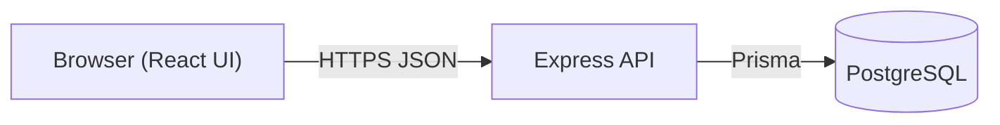

# System-Level Software Design Specification (SDS)

> **Project Deliverable 1, Part C.** Feature contracts in `docs/sprints/sprint-*/` give the detailed endpoints;
> this document defines the shared architecture, data model, conventions, access rules, and delivery design.
> Status: skeleton.

## Version history

| Version | Date | Author | Change | Reason |
|---|---|---|---|---|
| 0.1 | 2026-11-14 | | Skeleton created | Repository structure |

---

## 1. Stack and component responsibilities

| Layer | Technology | Responsibility |
|---|---|---|
| UI | React 18 + Vite | |
| API / application | Node 22 + TypeScript, Express 4 | |
| Data access | Prisma 5 | |
| Database | PostgreSQL | |
| Tests | Vitest + Supertest, Playwright | |
| Packaging / deploy | Docker, GCP (see section 9) | |

## 2. Architecture

<!-- Diagram (Mermaid is fine), how the components communicate, and WHERE business rules and authorization are enforced. -->

## 3. Data model

### 3.1 Entities

| Entity | Key fields | Relationships | Constraints | Owner / ownership link |
|---|---|---|---|---|
| | | | | |

### 3.2 Diagram

<!-- ER diagram. -->

### 3.3 Database setup, migrations, and seed

<!-- How the DB is created, the migration policy (additive only), and the reproducible, idempotent seed (passwords from env vars). -->

## 4. UI

### 4.1 Screens and navigation

| Screen | Route | Roles | Purpose |
|---|---|---|---|
| | | | |

### 4.2 Shared UI behaviour

| State | Behaviour |
|---|---|
| Validation | |
| Loading | |
| Empty | |
| Error | |
| Unauthenticated / forbidden | |

## 5. API conventions

<!-- Base path, JSON shapes, status codes, validation, and safe error handling (no stack traces or private data in errors). -->

| Topic | Convention |
|---|---|
| Base path | |
| Authentication | |
| Success response shape | |
| Error response shape | |
| Status codes | |
| Validation | |

## 6. Roles and permission matrix

> Enforced in the backend on every protected operation. A hidden frontend control is not authorization.

| Operation | Requester | Reviewer | Unauthenticated | Record scope |
|---|---|---|---|---|
| | | | | |

## 7. Authentication and session

| Topic | Design |
|---|---|
| Credential storage / password hashing | |
| Login | |
| Session or token creation | |
| Expiry | |
| Current-user retrieval | |
| Logout | |
| Throttling / lockout | |

## 8. Configuration and secrets

<!-- Summary only; the full env var table lives in docs/labs/lab-05/deployment.md. -->

## 9. Deployment design (GCP)

| Component | Purpose |
|---|---|
| | |
